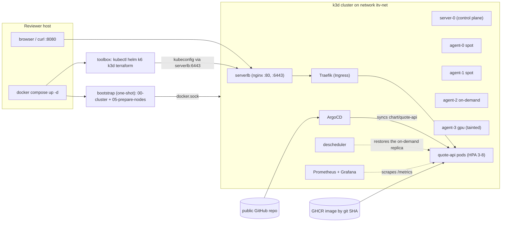
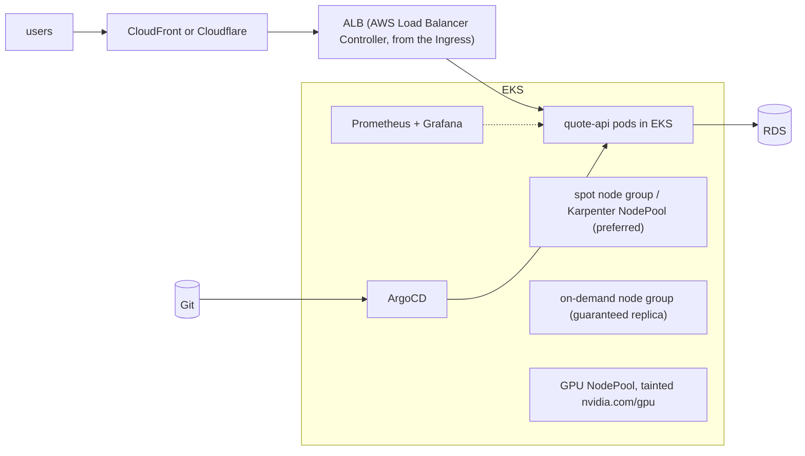

# DevOps take-home: quote-api on k3d, ArgoCD and spot/on-demand placement

<!-- TEMPLATE. Facts (commands, diagrams, tables) are filled in from what was built and measured; re-check them
     against the repo before you submit. Prose slots are marked "YOUR TEXT". Delete every comment when done.
     The reviewer reads the diagram BEFORE the code, so keep it correct and keep this file scannable. -->

<!-- YOUR TEXT (2 sentences): what this repo is and what a reviewer gets after the quick start. -->

## Quick start

Prerequisites: Docker (Desktop on Windows/macOS, with about 10 GB of RAM given to it) and a free host port 8080.

```bash
git clone https://github.com/OnlyLight/devops-takehome-solution && cd devops-takehome-solution
docker compose up -d
./scripts/run-all.sh        # about 12-15 minutes the first time; add --full for the 6-minute load test
```

Then, from the host:

| What | Where |
|---|---|
| The service | `curl http://localhost:8080/api/quote` |
| Grafana (dashboard "quote-api: load and scaling") | http://grafana.localhost:8080 (user `admin`, password: `docker compose exec toolbox kubectl -n monitoring get secret kps-grafana -o jsonpath='{.data.admin-password}' \| base64 -d`) |
| ArgoCD UI | not exposed; see Troubleshooting notes |

Image: `ghcr.io/onlylight/devops-takehome-solution/quote-api:sha-<git sha>` (public, linux/amd64 and linux/arm64).

## Architecture

<!-- Check this diagram against reality, then keep it. -->



<!-- YOUR TEXT (2-3 sentences): walk through the request path
     host :8080 -> serverlb -> svclb-traefik on a node -> Traefik -> Service -> pod, and say which node pools the pods may use. -->

## Script reference

| Script | What it does | When |
|---|---|---|
| `run-all.sh` | runs every numbered script below in order, stops at the first failure, prints a summary | the one command to run |
| `00-cluster.sh` | creates the k3d cluster (1 server, 4 agents) and writes the kubeconfig the toolbox uses | bootstrap (done by compose) |
| `05-prepare-nodes.sh` | runs the provided `prepare.sh`, then asserts 2 spot / 1 on-demand / 1 gpu | bootstrap |
| `20-deploy.sh` | installs ArgoCD and creates the Application that syncs `chart/quote-api` from this repo | after bootstrap |
| `22-descheduler.sh` | installs the descheduler that restores the on-demand replica after HPA scale-down | after 20 |
| `25-reclaim-drill.sh [spot\|od]` | drains a node that hosts the app under a curl loop, checks nothing fails, uncordons, rebalances | to prove the spot-reclaim survival |
| `30-troubleshoot.sh [--broken]` | applies the fixed (or the original broken) Part 3 manifests and runs `verify.sh` | Part 3 |
| `40-monitoring.sh` | installs Prometheus + Grafana and loads the dashboard | before the load test |
| `60-loadtest.sh` | k6 through the Ingress while recording HPA scaling, placement and the alert state | Part 6 |
| `lib/common.sh` | shared helpers (logging, `placement_table`) | sourced by the others |

## Design decisions and trade-offs

<!-- Keep each as 1-3 sentences: WHAT you chose, WHAT it costs, and the evidence. These are the questions the
     reviewer will ask live. -->

- **Placement (Part 2).** Required node affinity on the capacity label, a preference for spot, a hard topology spread across the two capacity domains (`maxSkew: 2`, `nodeTaintsPolicy: Honor`, `matchLabelKeys: pod-template-hash`) and a soft spread across hostnames. <!-- YOUR TEXT: why each layer exists; what a hard spread with the default policy does during the drill (it leaves a pod Pending: shown with a control experiment); what it costs (when the HPA goes above 3 replicas the extras spill to on-demand). -->
- **The descheduler.** <!-- YOUR TEXT: the problem (HPA scale-down left 3 spot + 0 on-demand in 2 of 3 cycles), why topologySpread cannot prevent it, what the descheduler does, the narrow policy, and the 51 s recovery measured. -->
- **GitOps flow.** <!-- YOUR TEXT: ArgoCD syncs the chart from Git; the image tag is bumped by a commit (the tag must already exist on GHCR, so two commits: build, then bump); selfHeal means no hard-coded replicas. -->
- **The service.** <!-- YOUR TEXT: a fixed amount of CPU work per request (calibrated at start-up) rather than a wall-clock spin; the baseline showed the spin never saturated a CPU-limited pod. -->
- **Load test and observability.** <!-- YOUR TEXT: open-model k6, thresholds from the baseline, why a latency alert rather than a 5xx alert. See LOADTEST.md. -->
- **Chart security context.** Non-root, read-only root filesystem (required by the task) plus no privilege escalation, all capabilities dropped and the RuntimeDefault seccomp profile (extras, marked in the chart). <!-- YOUR TEXT: why. -->

## What I cut, and why

<!-- The task says: "knowing what to skip is a senior skill". Fill the "why" column honestly. -->

| Cut | Why (YOUR TEXT) |
|---|---|
| Part 4 (GitHub Actions migration with a hard-failing SAST gate) | <!-- time; Part 6 was chosen as the track; what exists instead: a minimal workflow that tests, builds and pushes by SHA --> |
| Part 5 (Karpenter, Cloudflare Terraform) | <!-- time; one track is enough --> |
| Alertmanager | <!-- the task needs an alert rule, not a notification channel; saves memory --> |
| TLS on the Ingress, cosign, tracing, multi-environment values | <!-- --> |
| ArgoCD UI exposure, a second Traefik replica | <!-- --> |

## Troubleshooting notes (reviewer machine)

<!-- Keep 2-3. Candidates with the facts already known: -->

- **Port 8080 is taken.** `HOST_PORT=8081 docker compose up -d` (set it before the first `up`; see `.env.example`). <!-- YOUR TEXT: verify the exact steps on a machine where 8080 is busy -->
- **Not enough memory.** The stack needs about 10 GB for Docker: Docker Desktop on Windows uses WSL2, give it memory in `%UserProfile%\.wslconfig` (`[wsl2] memory=10GB`), then `wsl --shutdown`.
- **Windows/Git Bash.** Scripts are bind-mounted into Linux containers, so line endings must be LF (`.gitattributes` enforces it); Git Bash rewrites `/scripts/...` into a Windows path unless `MSYS_NO_PATHCONV=1` (`run-all.sh` sets it).
- **Apple Silicon / arm64.** The toolbox and the app image are built for amd64 and arm64.
- **Start over.** `docker compose down -v` does not delete the cluster (k3d owns it): `docker compose exec toolbox k3d cluster delete itv`, then `docker compose down -v` and `docker compose up -d`.
- **ArgoCD UI.** Not exposed. From the host: create a kubeconfig for the host (`docker compose exec -T toolbox k3d kubeconfig get itv`, replace the `server:` host with `127.0.0.1`) and `kubectl -n argocd port-forward svc/argocd-server 8081:443`.

## Findings in the provided files (imperfect handoff)

<!-- The task grades how you handle broken or missing handoff material. These are the real findings; write each as
     "what I saw, what I did". Add the ones you hit yourself, delete any you did not. -->

| File | Finding | What I did |
|---|---|---|
| `prepare.sh` | needs `kubectl` and a working kubeconfig inside the toolbox (not stated); says "Run ONCE" but is idempotent (`--overwrite`); assigns roles by alphabetical node order | wired the kubeconfig in `00-cluster.sh`, run it unmodified, then assert 2 spot / 1 on-demand / 1 gpu in `05-prepare-nodes.sh` |
| the control-plane node | schedulable and unlabeled, so any pod without affinity can land on it | the chart's required node affinity excludes it |
| `verify.sh` | passes only on the NAME of `default-deny`, not on it still denying everything; waits 60 s per rollout | kept it unmodified; `30-troubleshoot.sh` waits for the rollouts first; negative tests added in `TROUBLESHOOTING.md` |
| `verify.sh` smoke step | can print PASS without the DNS allow rule, because the first name lookup can win a start-up race | added the DNS rule anyway; documented in `TROUBLESHOOTING.md` |
| the task | does not say how to run k3d inside compose (docker.sock, ports, CRLF, arm64) | designed it in `docker-compose.yml` and the toolbox image |
| Part 2 vs Part 3 | the node label is `acme.io/node-type`, `broken-app.yaml` selects `node-type` | fixed the workload, never the node |

## More

- `TROUBLESHOOTING.md`: Part 3, one entry per fault.
- `LOADTEST.md`: Part 6 results and what they mean.
- `OPS-ANSWERS.md`: Part 7.
- `AI-USAGE.md`: how AI was used and where it was wrong.
- `VERSIONS.md`: every pinned version and where it was checked.

## Bonus: the same service on AWS

<!-- OPTIONAL. Boxes and arrows, not marketing art. A starting point to edit (check every box is something you can defend): -->


